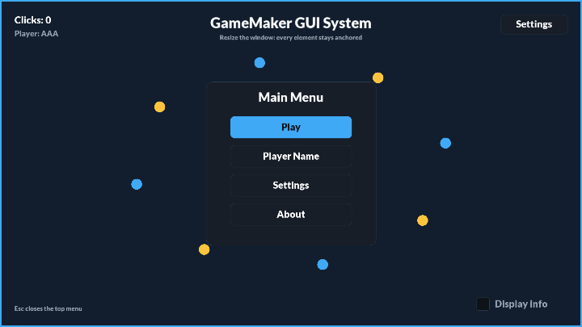
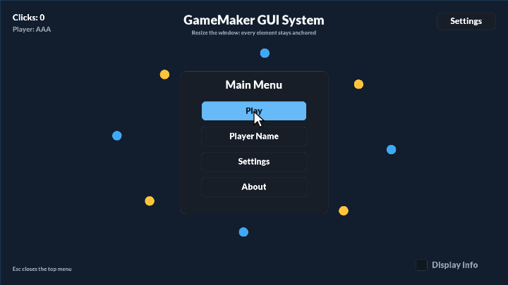
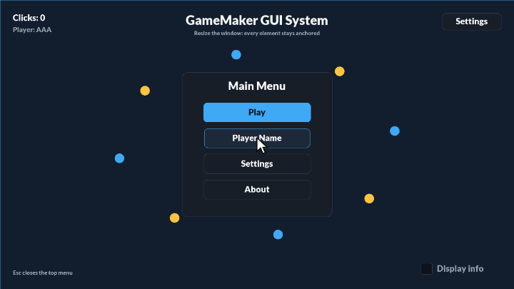
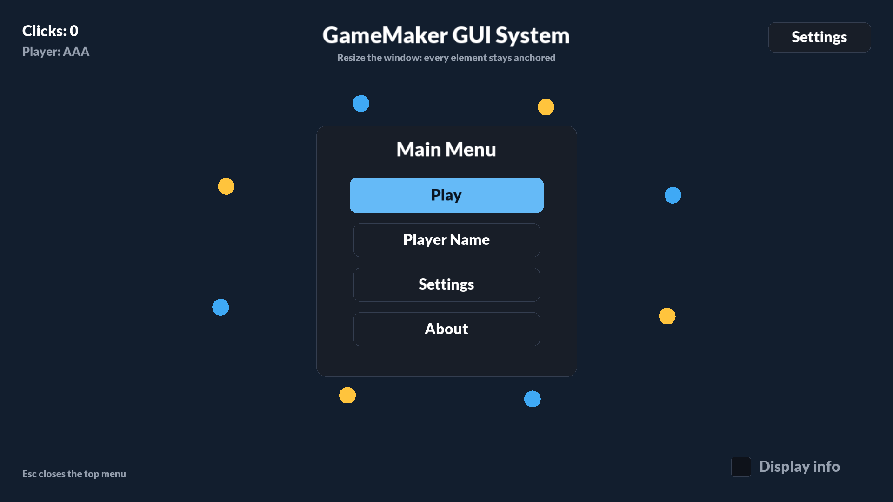
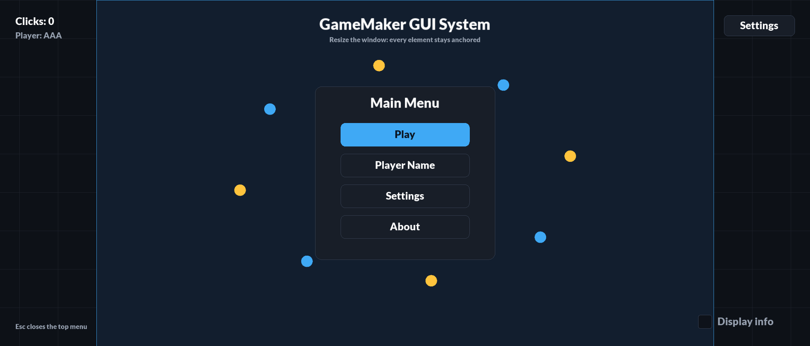
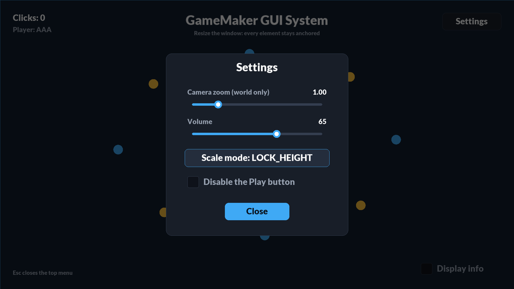
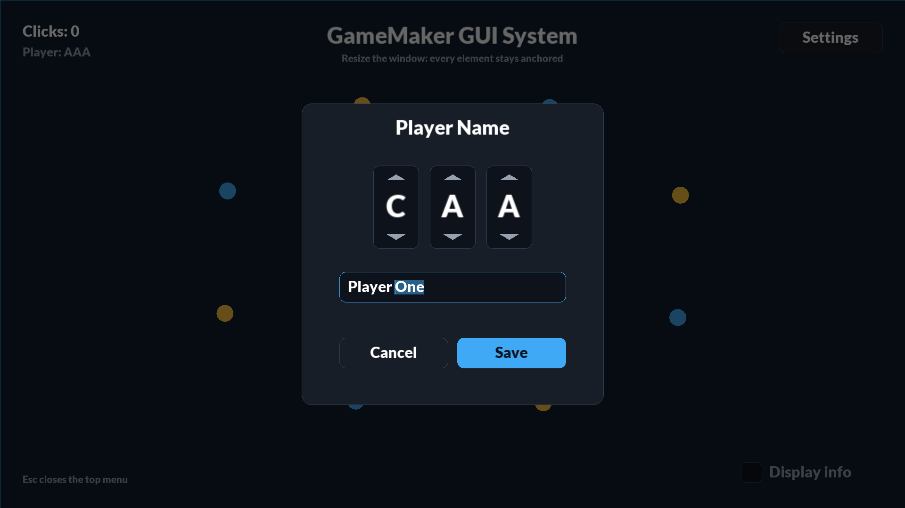
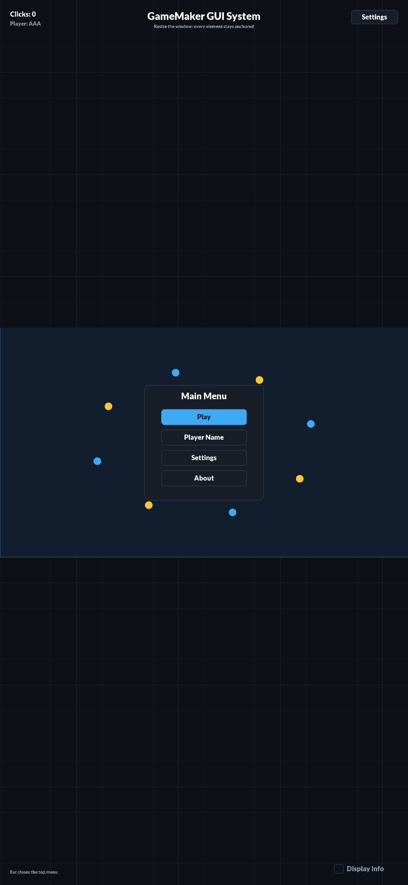

# GameMaker GUI System

An object-based GUI framework for GameMaker. You lay out a screen once at a fixed design resolution, and it stays pinned to the right edges on any window, aspect ratio or phone. Elements are plain objects, so you can place them in the Room Editor or create them from code. A single manager takes care of drawing, pointer input, keyboard focus and a stack of menus.

**[Live demo](https://dannytran-dev.github.io/gamemaker-studio-2-gui-system/)**: resize the window or open it on a phone.

It runs on top of the [HTML5 Display Scaler](https://github.com/dannytran-dev/gamemaker-studio-2-html-display-scaler), which handles sharp HiDPI rendering and resizing. The GUI reacts to the scaler's resize events, and the scaler knows nothing about the GUI.



| Menus, sliders and overlays | Letter wheels and text input |
|---|---|
|  |  |

<details>
<summary>Screenshots</summary>

| 16:9 desktop | 21:9 ultra-wide |
|---|---|
|  |  |

| Sliders, button, checkbox | Letter wheels, text input | Phone portrait |
|---|---|---|
|  |  |  |

</details>

## Quick start

1. Copy the **Display Scaler** and **GUI System** folders into your project, leaving out **GUI System / Demo**.
2. Set your design resolution in `scr_display_scaler_config` (`BASE_WIDTH` × `BASE_HEIGHT`, 1920 × 1080 by default) and make your rooms that size.
3. Put one `oDisplayScaler` in your first room.
4. Add elements. Place them in a room and set their Variable Definitions, or create them from code:

```gml
// A button pinned 48px from the top-right corner of every screen
gui_create(oGUIButton, BASE_WIDTH - 48 - 110, 80, {
	anchor: DisplayAnchor.TOPRIGHT, width: 220, height: 64,
	label: "Pause", onClick: pause_game,
});

// A modal dialog with its own buttons
gui_menu_open(oGUIMenu, {
	title: "Paused", width: 500, height: 360, dismissable: true,
	build: build_pause_menu,	// function(menu) { menu.add(oGUIButton, 0, 40, { label: "Resume", onClick: gui_menu_close_top }); }
});

// Keep game clicks from going through the UI
if (mouse_check_button_pressed(mb_left) && !gui_is_mouse_over()) shoot();
```

Tested with GameMaker IDE 2024.4.1 and runtime 2024.4.1.201, on the HTML5 and Windows targets.

## How it works

```
 oDisplayScaler ── RESIZE event ──► oGUIManager.relayout()
                                       │  every element: x = display_gui_anchor_x(baseX, anchor)
                                       │                 y = display_gui_anchor_y(baseY, anchor)
                                       ▼
 Begin Step   oGUIManager: pointer in GUI space (DPR-corrected)
                 ├─ topmost interactive element under it ─► on_hover(true/false)
                 ├─ button down  ─► focus + on_press      (the element is captured)
                 ├─ button held  ─► on_drag               (follows the pointer anywhere)
                 └─ button up    ─► on_release(isOver)    (a click only if still over it)
 Draw GUI     oGUIManager: draw_element() on each element, back to front
```

- **One manager, deterministic input.** GameMaker runs instance events in no guaranteed order, so elements that each poll the mouse can disagree about what was clicked. Instead, `oGUIManager` resolves hover, press, drag and release once per frame in Begin Step, before any element's Step runs. Only the topmost element gets the pointer, and the element the button went down on keeps getting drag and release until the button comes up. That is what makes sliders usable on touch screens.
- **Authored once, anchored everywhere.** An element's room position is its position at `BASE_WIDTH × BASE_HEIGHT`. Its `anchor` (one of the scaler's nine `DisplayAnchor` points) decides which edge or centre it keeps its distance to. Elements are re-anchored only when the scaler fires `RESIZE`, not every frame.
- **Menus own their elements.** `menu.add()` creates an element positioned relative to the menu, sharing its anchor. When the menu hides, its elements hide; when it is destroyed, they are destroyed. Screens never have to switch their own buttons on and off.
- **Modal by geometry.** A menu with `overlay` is a full-screen, input-absorbing element drawn above everything created before it, so it blocks the HUD and the menus underneath without disabling them. `hideBelow` hides the menus underneath until it closes.
- **Methods, not user events.** Elements override `draw_element()`, `hit_test()` and the `on_*` hooks after `event_inherited()`. Configuration lives in Variable Definitions and runtime state in Create, so anything configurable can be set in the Room Editor or through `gui_create`'s struct.

## Elements

Every element inherits these Variable Definitions from `oGUIElement`:

| Variable | Default | |
|---|---|---|
| `anchor` | `DisplayAnchor.MIDDLECENTER` | Screen point the element is pinned to |
| `width`, `height` | per element | Size in GUI units; also the hit box, centred on x / y |
| `enabled` | `true` | Disabled elements draw faded and ignore input |
| `visible` | `true` | GameMaker's built-in; hidden elements are not drawn or hit |

| Object | Variable Definitions | Callback |
|---|---|---|
| `oGUIText` | `text`, `font`, `colour`, `scale`, `maxWidth` (wrap). Alignment follows the anchor | none |
| `oGUIImage` | `sprite`, `frame`, `colour`. Fits inside `width × height`, keeping its aspect ratio | none |
| `oGUIButton` | `label`, `primary` (accent fill), `skin` (optional sprite: normal / hover / pressed frames, nine-slice friendly) | `onClick(button)` |
| `oGUICheckbox` | `checked`, `label` | `onChange(checked, checkbox)` |
| `oGUISlider` | `value`, `minValue`, `maxValue`, `step`, `decimals`, `label` | `onChange(value, slider)` |
| `oGUIInputField` | `text`, `placeholder`, `maxLength` | `onChange(text, field)`, `onSubmit(text, field)` |
| `oGUILetterWheel` | `letters`, `index`. Arcade-style initials picker; top half / scroll up = next | `onChange(letter, wheel)` |
| `oGUIMenu` | `title`, `overlay`, `hideBelow`, `dismissable` (Esc or click outside), `build` | `build(menu)` |

**Input field** supports caret placement by click, drag and Shift+Arrow selection, double-click word selection, Home/End, Ctrl+Arrow word jumps, Ctrl+Backspace/Delete, held-key repeat, Ctrl+A/C/X/V (Cmd on macOS), Enter to submit and Esc to blur. Long text scrolls to keep the caret in view. Text is clipped through a surface rendered at the screen's pixel density, so it stays as sharp as the rest of the GUI on HiDPI screens. Native Android and iOS builds open the on-screen keyboard on focus.

### Callbacks and method binding

Callbacks are called with the element as an extra argument, so one function can serve many elements:

```gml
close_owner = function(_button) { _button.get_menu().close(); };
menu.add(oGUIButton, 0, 200, { label: "OK", onClick: close_owner });
```

In GML, a function written inline inside a struct literal (`{ onClick: function() { ... } }`) is bound to that struct, not to the instance creating it. Pass instance methods by reference, as above, or wrap the function with `method(id, ...)` when the callback needs the instance's variables.

## API

| Function | Description |
|---|---|
| `gui_create(object, x, y, [vars])` | Create an element at a BASE-space position, with Variable Definition values |
| `gui_menu_open(menuObject, [vars])` | Open a menu on top of the stack (centred unless `vars` sets x / y) |
| `gui_menu_close(menu)` / `gui_menu_close_top()` | Close a menu and its elements; menus hidden under it reappear |
| `gui_menu_top()` / `gui_menu_count()` | Inspect the menu stack |
| `gui_focus(element)` / `gui_get_focus()` | Set or read keyboard focus (`noone` clears it) |
| `gui_is_mouse_over()` | True while the pointer is over interactive UI |
| `gui_mouse_x()` / `gui_mouse_y()` | Pointer position in GUI space |
| `gui_bring_to_front(element)` | Draw an element above the others and give it input priority |
| `gui_relayout()` | Re-anchor everything (runs on its own on resize) |
| `gui_theme()` | Shared colours, font, corner radius; edit it in place to restyle every element |
| `gui_set_align(anchor)`, `gui_draw_box(...)`, `gui_draw_label(...)` | Drawing helpers for custom elements |

On an element: `set_position(x, y)` (BASE space), `layout()`, `is_shown()`, `can_interact()`, `is_focused()`, `get_menu()`, plus the setters each element exposes (`set_text`, `set_label`, `set_value`, `set_checked`, `set_letter`, `set_sprite`).

## Writing your own element

Make a child of `oGUIElement`, set `interactive_` (and `focusable_` for keyboard input), and override what you need:

```gml
// oGUIToggle - Create
event_inherited();
interactive_ = true;
on = false;

on_release = function(_x, _y, _isOver) {
	if (_isOver) on = !on;
};

draw_element = function() {
	var _theme = gui_theme();
	gui_draw_box(x - width / 2, y - height / 2, x + width / 2, y + height / 2,
		on ? _theme.accent : _theme.panel, _theme.border, get_alpha(), height / 2);
};
```

Hooks: `on_hover(isOver)`, `on_press(x, y)`, `on_drag(x, y)`, `on_release(x, y, isOver)`, `on_focus(isFocused)`. Override `hit_test(x, y)` for non-rectangular shapes.

## Notes

- **HTML5 input timing.** GameMaker's HTML5 runner samples input once per frame. A press and release (or key down and up) that both happen inside one frame never reach GML. Real clicks and keystrokes last longer than a frame, but automated UI tests should hold inputs for at least a frame or two.
- **Scale modes.** The demo switches the scaler to `DisplayScaleMode.EXPAND` so the whole layout stays visible on portrait phones. With `LOCK_HEIGHT`, a portrait screen shows only a narrow slice of the BASE width, so edge-anchored elements can overlap.
- **Draw order** is creation order. Menus opened later sit above everything created before them, and their elements sit above the menu. `oGUIManager` runs at `GUI_DEPTH` so the GUI draws over other Draw GUI events.

## Project layout

| Folder | Contents |
|---|---|
| **Display Scaler** | `oDisplayScaler`, its scripts and JS extension, copied unchanged from the [display scaler](https://github.com/dannytran-dev/gamemaker-studio-2-html-display-scaler) |
| **GUI System / Core** | `oGUIManager`, `oGUIElement`, `oGUIMenu` |
| **GUI System / Elements** | Text, image, button, checkbox, slider, input field, letter wheel |
| **GUI System / Scripts** | `scr_gui` (API), `scr_gui_menu`, `scr_gui_text` (word / caret helpers), `scr_gui_config` (theme and tuning) |
| **GUI System / Demo** | `rmGUIDemo`, `oGUIDemo`, `sGUIDemoIcon`; delete once your project has its own rooms |

To try the demo, open `gamemaker-studio-2-gui-system.yyp`, choose the **HTML5** or **Windows** target and run.
